# Ask the Archive

**1st place, The Document Warehouse × AWS User Group Windhoek Innovation Challenge (19–20 November 2026)**

Ask the Archive is an AI assistant over a client's archived documents. People ask questions in plain language and get answers built only from the documents they are allowed to see. Every fact links to its source page, with the cited line highlighted. When the documents don't cover a question, it says so rather than guessing.

For The Document Warehouse (TDW), it does one more thing: it knows which warehouse box holds each paper original. Staff can find any box in seconds without ever seeing what is inside it.

> This is a showcase repository. The source code is private while the product is developed further by [PulsarFlow Technologies](https://github.com/PulsarflowTechnologies).

---

## The problem

Organisations keep years of leases, contracts, invoices, policies, minutes and correspondence in storage. When someone needs an answer, someone else has to find the right box, the right file and the right page. That takes days, and it relies on people who know where things are.

The challenge: build an assistant that

1. answers plain-language questions **across** documents,
2. summarises a single document,
3. links every answer to its source,
4. respects access rights, and
5. says "I don't know" instead of inventing an answer.

## What we built

| Requirement | How Ask the Archive does it |
| --- | --- |
| Answers across documents | Ask "Which leases expire next year?" and get every matching lease, with dates taken from the leases and their amendments |
| Summarises a document | A **Summarise** button on every document |
| Links answers to sources | Numbered citations open the exact page, with the supporting line highlighted on the scanned or digital page |
| Respects access rights | Different roles asking the same question get different answers, with no hint that restricted documents exist |
| Says "I don't know" | Questions outside the documents get a clear "not covered", what was searched, and better questions to try |

**Beyond the brief**

- **Messy documents:** scans, phone photos, handwritten notes, emails with attachments, spreadsheets and web pages. Handwriting is auto-rotated and shown next to its transcript.
- **Versions and amendments:** current, superseded, draft and duplicate documents are told apart, and an amendment's new end date wins over the original's.
- **Key details extracted:** parties, dates, amounts and notice periods are pulled out per document, so list questions are exact.
- **Physical originals:** each answer shows which box holds the paper original, with one click to request it.
- **Staff box locator:** a 3D and 2D warehouse view that flies to the box, shows its bay and level, and draws a walking route from the dock. Staff see location only, never contents.
- **Audit log:** a record of who asked what, which sources were used, refusals and role switches.
- **Voice:** read-aloud answers and spoken questions.

## Results

We tested the system against answer keys for two very different document sets: one clean, one deliberately messy.

| Dataset | Score | Leaks of restricted content |
| --- | --- | --- |
| Property company (clean, digital) | 34 / 36 | 0 |
| Law firm (scans, handwriting, emails, duplicates) | 32 / 35 | 0 |

## How it works

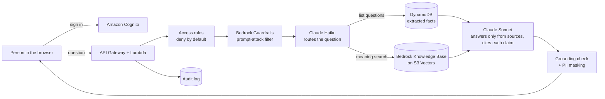

1. **Who is asking:** the sign-in and role decide what the person may see. Everything is denied by default.
2. **Safety:** Amazon Bedrock Guardrails blocks attempts such as "ignore your rules".
3. **Route:** a fast model decides whether the question is a list, a meaning search, a summary, an exact lookup or a box location.
4. **Search, filtered twice:** results are filtered by role at search time, then every result is checked against the access rules again before the AI sees it.
5. **Answer:** Claude writes only from those sources and cites each claim to a document and page.
6. **Check:** the answer is checked against the source text. Weakly supported answers become "not covered".
7. **Record:** every question, answer and refusal goes to the audit log.

**Highlighting:** during ingestion, every line on every page is stored with its position. When an answer cites a page, the dates, amounts and names in that claim are matched to the lines on that page, and those lines are highlighted.

## Built with

All on AWS in Stockholm (eu-north-1), defined as code with **AWS CDK**.

| Layer | Services |
| --- | --- |
| Sign-in | Amazon Cognito |
| API | Amazon API Gateway, AWS Lambda (Python, FastAPI) |
| AI | Amazon Bedrock: Claude Sonnet 4.6 (answers, extraction, vision OCR), Claude Haiku 4.5 (routing) |
| Search | Amazon Bedrock Knowledge Bases on Amazon S3 Vectors, Titan Text Embeddings V2 |
| Safety | Amazon Bedrock Guardrails |
| Data | Amazon DynamoDB, Amazon S3 |
| Website | React, TypeScript, Tailwind, React Three Fiber, hosted on S3 + Amazon CloudFront |
| Voice | Amazon Polly, browser speech recognition |

## Screenshots

| | |
| --- | --- |
| 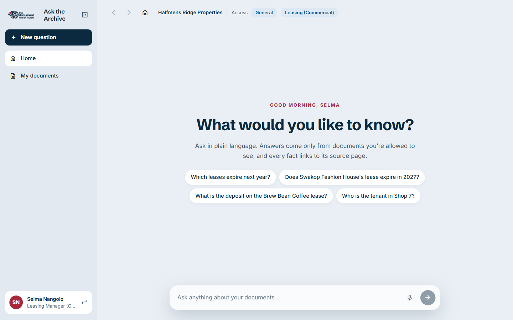 **Home.** Ask in plain language; the line under the top bar shows the organisation and this role's access. | 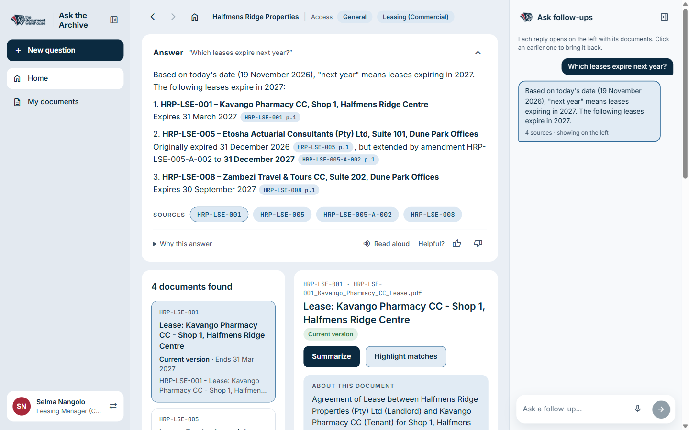 **Answer with sources.** Every fact is numbered and linked to its document and page. |
| 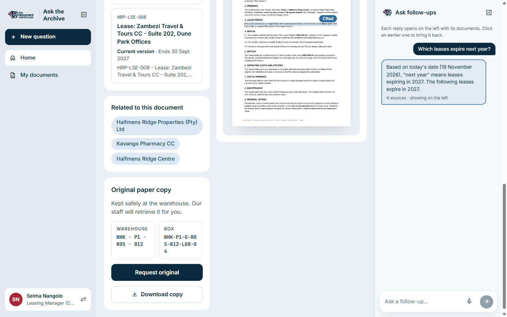 **The exact line, highlighted** on the original page, next to the paper original's box. | 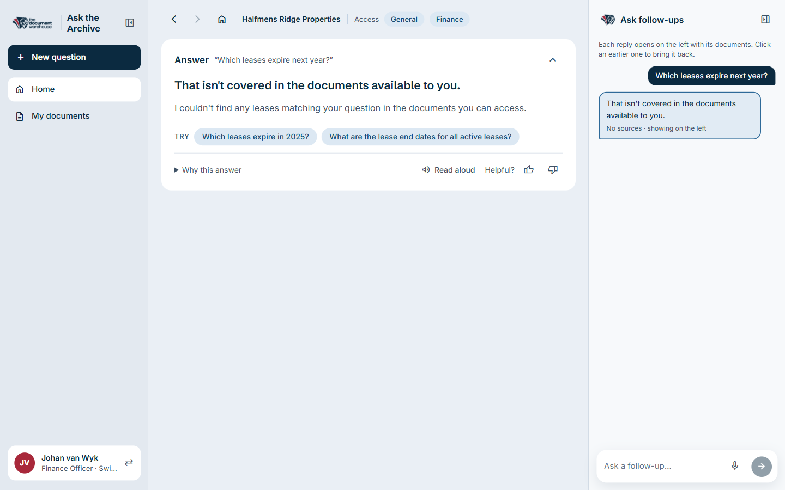 **Access rights.** The same question from a role without access gets no answer and no hint. |
|  **Says when it doesn't know,** and suggests better questions. | 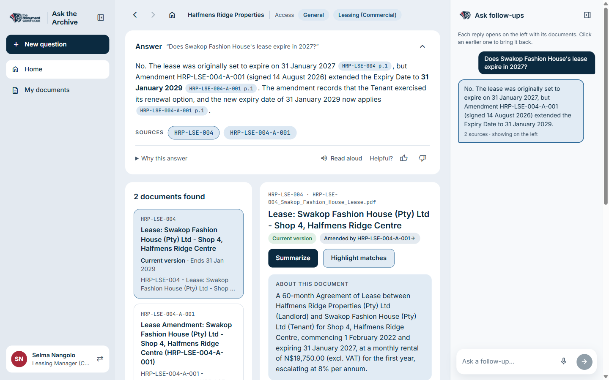 **Reads amendments.** An original end date of 2027, extended to 2029 by a signed amendment. |
| 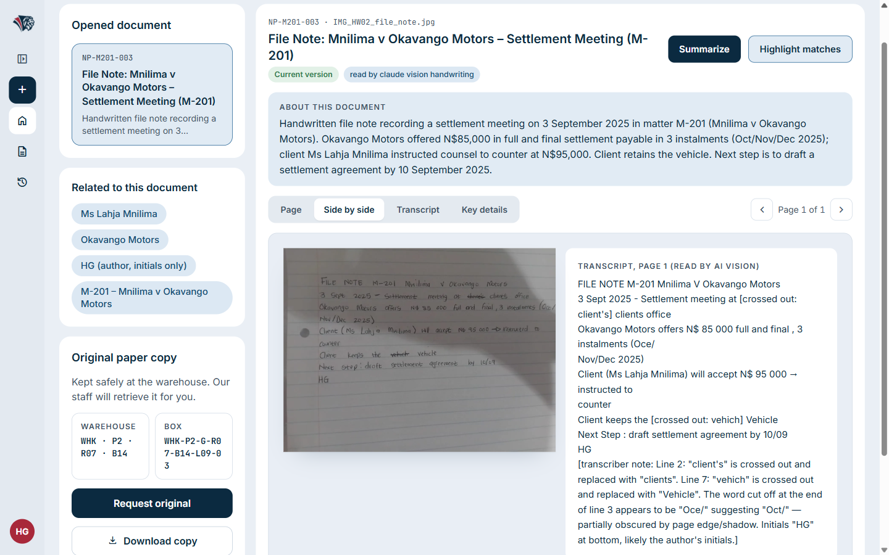 **Handwriting and scans,** auto-rotated and shown next to the transcript. | 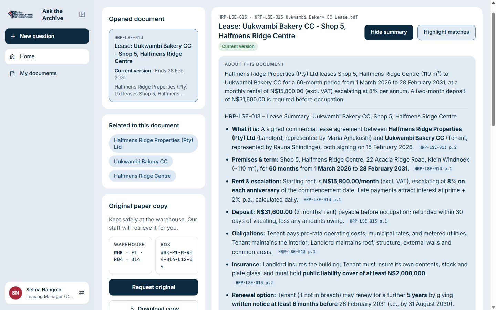 **One-click summary** of any document. |
| 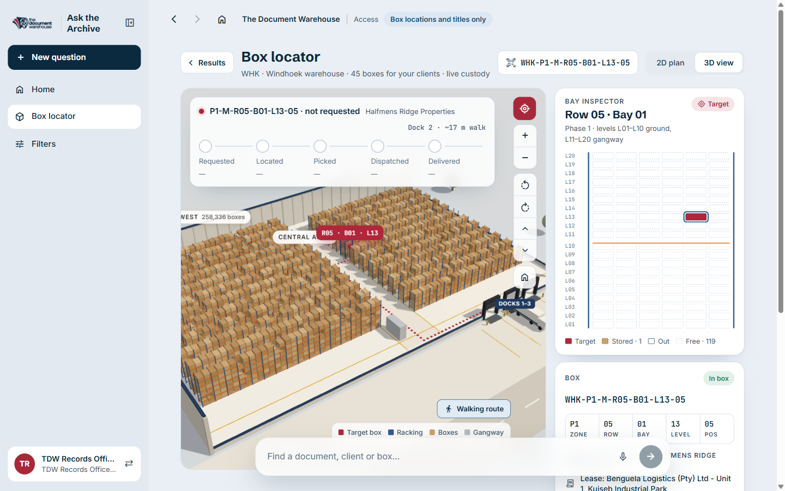 **Staff box locator (3D)** flies to the box and draws the route from the dock. | 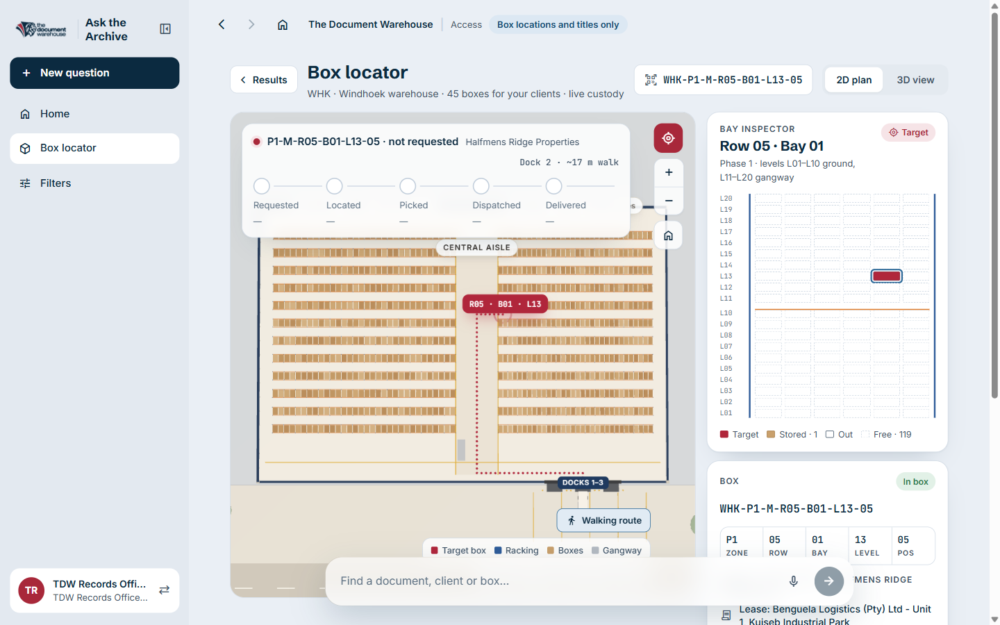 **2D floor plan** with the bay and level. Staff never see contents. |
| 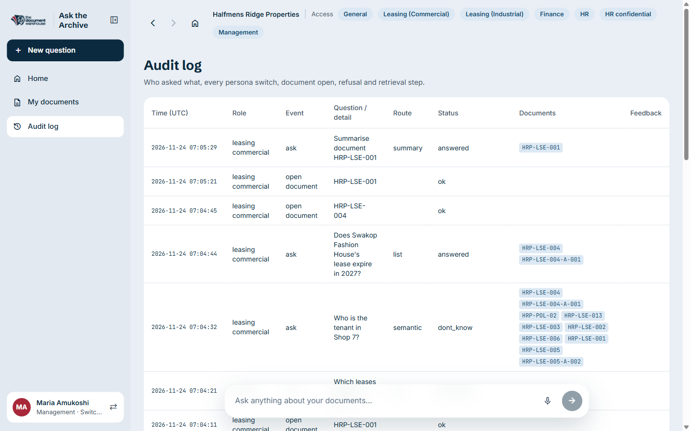 **Audit log** of who asked what. | 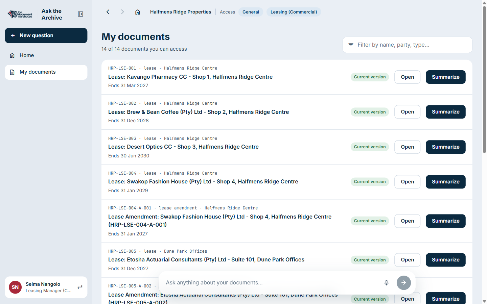 **My documents:** everything this role can open. |

## What's next

Feedback from the judges shaped the next steps:

- **Strict client separation** enforced by the cloud itself, not just the application, so each client only ever sees its own documents.
- **Real sign-in per person** (for example through a client's Microsoft 365), replacing the demo role switcher.
- **Browser upload** of new documents through the same ingestion pipeline.
- **A pilot** with a records-management partner.

More detail: [How it works, in plain English](docs/how-it-works.md).

Interested in Ask the Archive for your organisation? Contact [PulsarFlow Technologies](https://github.com/PulsarflowTechnologies).

---

_The demo used two invented organisations and synthetic documents created for the challenge. No real client data was used._
