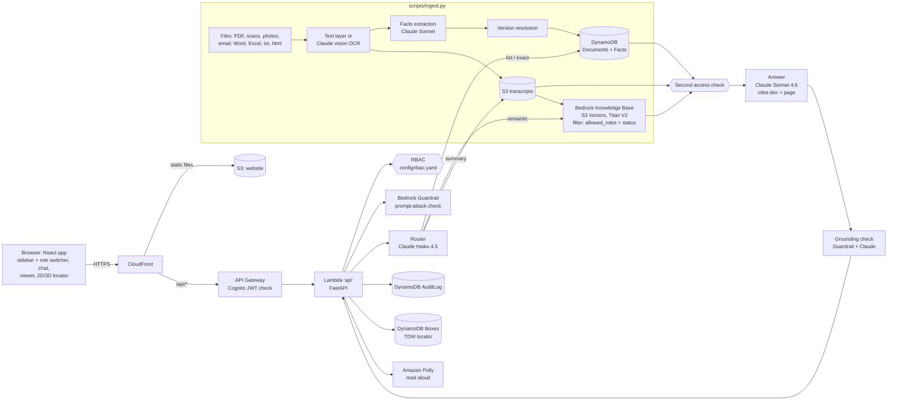

# How Ask the Archive works (plain English)

*Kept up to date as we build. Aimed at a judge or a teammate who wants to explain any part of it.*

## The idea in one paragraph

A client of The Document Warehouse (TDW) has thousands of archived documents. Instead of requesting boxes and
reading files, staff type a question like "Which leases expire next year?". Ask the Archive finds the answer
in the documents that person is allowed to see, writes a short answer, and links each fact to the exact page
it came from. If the documents don't contain the answer, it says "I don't know" instead of guessing.

## Architecture at a glance

## The AI models we use (and why)

| Job | Model | Why |
|---|---|---|
| Writing answers, pulling out dates and amounts, reading scans | Claude Sonnet 4.6 | Strongest model available to our AWS account in Stockholm |
| Deciding what kind of question it is ("list", "summary", ...) | Claude Haiku 4.5 | Fast and cheap; it only returns a small JSON decision |
| Turning text into searchable vectors | Amazon Titan Text Embeddings V2 | Runs in our Region, multilingual (Afrikaans, German) |

Everything runs in the AWS Stockholm Region (eu-north-1), so data stays in the EU.

## Reading scanned and handwritten documents

Amazon Textract (AWS's OCR service) is blocked for our hackathon account by an organisation policy, so we use
Claude's vision ability to read every scanned page, phone photo and handwritten note. We tested it on a
skewed, stamped scan and got a clean, word-for-word transcript.

## Who can see what (access control)

Every person has a **role** (e.g. Finance Officer). Every document has one or more **access classes**
(e.g. `finance`, `management`). A person can see a document only if it belongs to their organisation **and**
their role holds at least one of its classes. Everything else is hidden by default.

- Rules live in one file, `config/rbac.yaml`; which document gets which class is in `config/doc_classes.yaml`.
- We check twice: the search engine only searches documents the role may see, and then every result is
  checked again against the document register before the AI reads it.
- If you're not allowed to see something, the app behaves exactly as if it doesn't exist. It never says
  "there is a document you can't see".
- For the demo there is one login that can "act as" any persona. The server only accepts this because that
  login is in a special `demo_switcher` group, and every switch is recorded in the audit log.

## How documents get in (ingestion)

`scripts/ingest.py` reads every file in a dataset folder:
1. **Fingerprint** each file (SHA-256), so exact duplicates are recognised.
2. **Read the text.** For digital PDFs we read the text layer and note where every line sits on the page,
   so the viewer can highlight the exact cited line. We also save a picture of every page.
3. **Pull out key facts** (parties, start/end dates, rent, invoice numbers, due dates) with Claude. Money
   becomes N$ numbers, dates become calendar dates, and "60 months from 1 February 2022" becomes 31 January
   2027. Every fact remembers which page it came from.
4. **Work out versions.** If an amendment extends a lease, the lease's *effective* end date changes, so
   "Which leases expire next year?" doesn't list Swakop Fashion House (its amendment extended it to 2029).
5. **Store everything**: page images and transcripts in S3, the document register and facts in DynamoDB,
   and the transcript in the search index (Bedrock Knowledge Base), tagged with who may see it.

## What happens when you ask a question

1. **Who are you?** The server checks your login token and which persona you're acting as.
2. **Is the question safe?** A guardrail blocks prompt-injection attempts ("ignore your rules…").
3. **What kind of question is it?** A small, fast model (Claude Haiku) labels it:
   - *list*: "Which leases expire next year?" is answered from the extracted facts table, filtered exactly
     by date. This is precise and never misses a document.
   - *semantic*: "What does the leave policy say about sick leave?" searches the text for the best passages.
   - *summary*: "Summarise the Brew Bean lease" reads the whole document.
   - *exact*: an invoice number or document ID is looked up directly.
4. **Find the sources**, but only from documents you may see, then check each one a second time.
5. **Write the answer** with Claude Sonnet, using only those sources. Every fact gets a citation like
   `[HRP-LSE-001 p.1]`, which links to the page image with the supporting line highlighted.
6. **If the sources don't answer it**, the reply is "I don't know" plus two suggested rephrasings. It never
   guesses, and never mentions documents you can't see.
7. **Everything is logged**: who asked what, which documents were used, and the outcome.

## Messy documents (Dataset 2)

Real shared drives are messy, and the pipeline handles each kind:
- **Scans, phone photos and handwritten notes** are read by Claude's vision. First we find which way is up:
  we show the AI the page in all four orientations and ask which one reads normally. Then it transcribes
  every line word for word, marking crossed-out and unreadable words instead of guessing. In the viewer you
  see the photo and its transcript side by side.
- **Emails** become one document for the message plus one per attachment, with the same access rights.
- **Word, Excel, text and web pages** are converted to text (spreadsheets become tables, cells as written).
- **Versions**: drafts, superseded policies and exact duplicates are recognised. Answers use the current
  version, but you can still ask about history ("how many copies do we have?").
- **Misspelt names** (Mwilima / Mwillima / Muilima) are matched as the same party.

## Safety nets (guardrails)

- **Before answering**: an AWS Bedrock Guardrail checks the question for prompt-injection ("ignore your
  rules…", "you are now in admin mode…") and refuses politely. It can't leak anything anyway, because the AI
  only ever sees documents the person is allowed to read.
- **After answering**: every cited sentence is checked against the passages it cites (Bedrock "contextual
  grounding"). If the answer isn't supported by the sources, the user gets "I don't know" instead.
- **Personal data**: phone numbers, email addresses and ID numbers in answers are masked.

## The screen
A sidebar on the left holds New question, the pages this role may use and, at the bottom, a card showing who you are acting
as; click it to switch role. The top bar shows the company and which access classes the role holds. You ask in the question box
at the bottom of the screen. The answer appears on top with its sources; underneath, the documents it found sit beside the page
viewer with the cited lines highlighted. A chat panel on the right lists every question asked this session, so you can click
back to an earlier answer, and the Back and Forward buttons (or the browser's) step through screens and answers.

## The Document Warehouse staff view (box locator)

TDW records officers can ask "Where is the box with the Benguela Logistics lease?" and get the exact box
(e.g. `WHK-P1-M-R05-B01-L13-05` = Windhoek, Phase 1, upper/gangway access, row 5, bay 1, level 13, position 5),
a floor plan with the bay highlighted and the walking route from the dock door, plus a side view showing the
shelf level. They can find and fetch boxes, but they can never read what's inside: every content screen is
refused for their role.

## Paper originals and retrievals

Every physical document sits in a box in the Windhoek warehouse. A client reading a lease sees an
"Original paper copy" panel with its box and can press **Request original**. TDW staff see that request in the
box locator, find the box in a 3D (or 2D) model of the warehouse with a walking route from the dock, and
move it through Requested → Located → Picked → Dispatched → Delivered. Each step is time-stamped, updates
the box's status for everyone, and is written to the audit log. Staff only ever see titles and locations,
never what is written inside.
